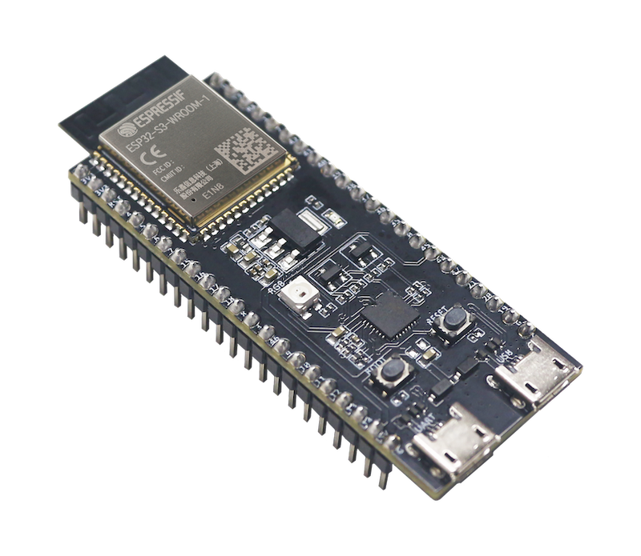
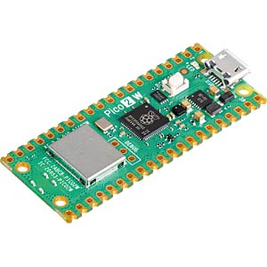

# mender-zephyr-example

[](https://github.com/joelguittet/mender-zephyr-example/actions)
[](https://github.com/joelguittet/mender-zephyr-example/actions)
[](https://github.com/joelguittet/mender-zephyr-example/issues)
[](https://github.com/joelguittet/mender-zephyr-example/blob/master/LICENSE)

[](https://sonarcloud.io/dashboard?id=joelguittet_mender-zephyr-example)
[](https://sonarcloud.io/dashboard?id=joelguittet_mender-zephyr-example)
[](https://sonarcloud.io/dashboard?id=joelguittet_mender-zephyr-example)
[](https://sonarcloud.io/dashboard?id=joelguittet_mender-zephyr-example)
[](https://sonarcloud.io/dashboard?id=joelguittet_mender-zephyr-example)

[](https://sonarcloud.io/dashboard?id=joelguittet_mender-zephyr-example)
[](https://sonarcloud.io/dashboard?id=joelguittet_mender-zephyr-example)
[](https://sonarcloud.io/dashboard?id=joelguittet_mender-zephyr-example)

[Mender MCU client](https://github.com/joelguittet/mender-mcu-client) is an open source over-the-air (OTA) library updater for MCU devices. This demonstration project runs on several hardware platforms using Zephyr RTOS.


## Getting started

This project is used with one of the following setup.

* [Espressif ESP32S3-DevKitC](https://docs.espressif.com/projects/esp-dev-kits/en/latest/esp32s3/esp32-s3-devkitc-1/index.html) development board

This board is well known and has a very low cost, providing a perfect choice to start developing applications using the embedded Wi-Fi interface.
It demonstrates storage of keys using PSA ITS API and Zephyr ZMS solution instead of the default NVS backend.



* [NXP FRDM-MCXN947](https://www.nxp.com/design/design-center/development-boards-and-designs/FRDM-MCXN947) development board

This board has Dual Arm Cortex-M33 cores and NPU and it targets AI and Machine Learning applications.


* [STMicroelectronics NUCLEO-L4A6ZG](https://www.st.com/en/evaluation-tools/nucleo-l4a6zg.html) development board

Together with an [ATECC608B](https://www.microchip.com/en-us/product/atecc608b) to provide device authentication and [W5500](https://wiznet.io/products/ethernet-chips/w5500) for Ethernet connectivity. The device tree overlay `app/boards/nucleo_l4a6zg.overlay` specifies the wiring of the crypto element and Ethernet controller used in the project.


* [RaspberryPi Pico 2W](https://www.raspberrypi.com/documentation/microcontrollers/pico-series.html) development board

Together with a [RaspberryPi Debug Probe](https://www.raspberrypi.com/documentation/microcontrollers/debug-probe.html) to provide a convenient way to flash and debug the project.



The project is built using Zephyr RTOS v4.5.0 and Zephyr SDK v1.0.1.

To start using Mender, we recommend that you begin with the Getting started section in [the Mender documentation](https://docs.mender.io).

To start using Zephyr, we recommend that you begin with the Getting started section in [the Zephyr documentation](https://docs.zephyrproject.org/latest/develop/getting_started/index.html). It is highly recommended to be familiar with Zephyr environment and tools to use this example.

### Initialize the project

Initiate a new workspace using the following commands. This will download the dependencies of the example application.

The projects depends on [cJSON](https://github.com/DaveGamble/cJSON) and [msgpack-c](https://github.com/msgpack/msgpack-c) (if troubleshoot add-on support is integrated, see below).

```
mkdir workspace-zephyr
cd workspace-zephyr
git clone https://github.com/joelguittet/mender-zephyr-example
cd mender-zephyr-example
git submodule update --init --recursive
python3 -m venv ../.venv
source ../.venv/bin/activate
pip install west
west init -l .
west update
west zephyr-export
west packages pip --install
west sdk install
```

### Configuration of the application

The example application should first be configured to set at least:
- `CONFIG_MENDER_SERVER_TENANT_TOKEN` to set the Tenant Token of your account on "https://hosted.mender.io" server.
- `CONFIG_EXAMPLE_WIFI_SSID` to set the SSID of the Access Point (for boards supporting Wi-Fi).
- `CONFIG_EXAMPLE_WIFI_PSK` to set the password of the network (for boards supporting Wi-Fi).

You may want to customize few interesting settings:
- `CONFIG_MENDER_DEVICE_TIER` if using Micro device tier on Mender server. Default is no tier configured.
- `CONFIG_MENDER_SERVER_HOST` if using your own Mender server instance. Tenant Token is not required in this case.
- `CONFIG_MENDER_CLIENT_AUTHENTICATION_POLL_INTERVAL` is the interval to retry authentication on the mender server.
- `CONFIG_MENDER_CLIENT_UPDATE_POLL_INTERVAL` is the interval to check for new deployments.
- `CONFIG_MENDER_CLIENT_INVENTORY_REFRESH_INTERVAL` is the interval to publish inventory data.
- `CONFIG_MENDER_CLIENT_CONFIGURE_REFRESH_INTERVAL` is the interval to refresh device configuration.

Other settings are available in the Kconfig. You can also refer to the mender-mcu-client API and configuration keys.

### Building and flashing the application

Some boards depends on binary blobs. You can download them using the following commands.

* Espressif ESP32S3-DevKitC development board
```
west blobs fetch hal_espressif
```
* RaspberryPi Pico 2W development board
```
west blobs fetch hal_infineon
```

The application relies on mcuboot and requires to build a signed binary file to be flashed on the evaluation board.

Use the following commands to build mcuboot and the application all together using sysbuild, depending of the board being used:

* Espressif ESP32S3-DevKitC development board
```
west build -b esp32s3_devkitc/esp32s3/procpu --sysbuild app
```
* NXP FRDM-MCXN947 development board
```
west build -b frdm_mcxn947/mcxn947/cpu0 --sysbuild app
```
* STMicroelectronics NUCLEO-L4A6ZG development board
```
west build -b nucleo_l4a6zg --sysbuild app
```
* RaspberryPi Pico 2W development board
```
west build -b rpi_pico2/rp2350a/m33_0/w --sysbuild app
```

Finaly flash the board using the following command. Both mcuboot and the application will be flashed.

* Espressif ESP32S3-DevKitC development board
* NXP FRDM-MCXN947 development board
* STMicroelectronics NUCLEO-L4A6ZG development board
```
west flash
```
* RaspberryPi Pico 2W development board (require a specific version of openocd)
```
west flash --openocd /usr/local/bin/openocd
```

### Execution of the application

Below logs are retrieved on Espressif ESP32S3-DevKitC development board.

After flashing the application on the development board and opening a terminal to display the logs, you should be able to see the following:

```
*** Booting Zephyr OS build v4.5.0 ***
WARNING: Using an insecure PSA ITS encryption key provider.
[00:00:00.042,000] <wrn> secure_storage: Using an insecure PSA ITS encryption key provider.
[00:00:00.047,000] <inf> mender_zephyr_example: Initialization of network interface
[00:00:00.047,000] <inf> mender_zephyr_example: Initialization of certificate(s)
[00:00:00.047,000] <inf> mender_zephyr_example: MAC address of the device 'cc:ba:97:0a:af:80'
[00:00:00.047,000] <inf> mender_zephyr_example: Running project 'mender-zephyr-example' version '0.1.0'
[00:00:00.047,000] <inf> mender_zephyr_example: Mender client version '0.13.2' initialized
[00:00:00.048,000] <inf> mender: WEST_TOPDIR/modules/lib/mender-mcu-client/platform/storage/generic/psa_its/src/mender-storage.c (228): Device configuration not available (-140)
[00:00:00.048,000] <inf> mender_zephyr_example: Mender configure add-on registered
[00:00:00.048,000] <inf> mender_zephyr_example: Mender inventory add-on registered
[00:00:00.048,000] <inf> mender_zephyr_example: Device configuration retrieved
[00:00:00.051,000] <inf> mender: WEST_TOPDIR/modules/lib/mender-mcu-client/platform/storage/generic/psa_its/src/mender-storage.c (161): Deployment data not available (-140)
[00:00:00.051,000] <inf> mender_zephyr_example: Mender client connect network
[00:00:00.051,000] <inf> mender_zephyr_example: Connecting to the network
[00:00:08.191,000] <inf> mender_zephyr_example: Got IPv4 event: 'NET_EVENT_IPV4_ADDR_ADD'
[00:00:08.191,000] <inf> mender_zephyr_example: IPv4 address: 192.168.1.157
[00:00:08.191,000] <inf> mender_zephyr_example: Lease time: 43200 seconds
[00:00:08.191,000] <inf> mender_zephyr_example: Subnet: 255.255.255.0
[00:00:08.191,000] <inf> mender_zephyr_example: Router: 192.168.1.1
Connected
[00:00:08.191,000] <inf> mender_zephyr_example: Connected to the network
[00:00:09.621,000] <inf> mender: WEST_TOPDIR/modules/lib/mender-mcu-client/platform/net/zephyr/src/mender-net.c (165): Connected to the host 'hosted.mender.io:443' with IPv4 address '3.233.133.10'
[00:00:10.035,000] <err> mender: WEST_TOPDIR/modules/lib/mender-mcu-client/core/src/mender-api.c (527): [401] Unauthorized: dev auth: unauthorized
[00:00:10.035,000] <inf> mender_zephyr_example: Mender client authentication failed
[00:00:10.035,000] <inf> mender_zephyr_example: Mender client released network
[00:00:20.035,000] <inf> mender_zephyr_example: Disconnecting network
[00:00:20.038,000] <inf> mender_zephyr_example: Got IPv4 event: 'NET_EVENT_IPV4_ADDR_DEL'
Disconnected (User request/2)
[00:00:20.038,000] <inf> mender_zephyr_example: Disconnected of the network
```

Which means you now have generated authentication keys on the device. Generating could be a bit long (depending of the hardware and depending of the mender-mcu-client configuration) but authentication keys are stored in the device so it's done only the first time the device is flashed. You now have to accept your device on the mender interface. Once it is accepted on the mender interface the following will be displayed:

```
[00:01:00.048,000] <inf> mender_zephyr_example: Mender client connect network
[00:01:00.048,000] <inf> mender_zephyr_example: Connecting to the network
[00:01:04.086,000] <inf> mender_zephyr_example: Got IPv4 event: 'NET_EVENT_IPV4_ADDR_ADD'
[00:01:04.086,000] <inf> mender_zephyr_example: IPv4 address: 192.168.1.157
[00:01:04.086,000] <inf> mender_zephyr_example: Lease time: 43200 seconds
[00:01:04.086,000] <inf> mender_zephyr_example: Subnet: 255.255.255.0
[00:01:04.086,000] <inf> mender_zephyr_example: Router: 192.168.1.1
Connected
[00:01:04.087,000] <inf> mender_zephyr_example: Connected to the network
[00:01:05.532,000] <inf> mender: WEST_TOPDIR/modules/lib/mender-mcu-client/platform/net/zephyr/src/mender-net.c (165): Connected to the host 'hosted.mender.io:443' with IPv4 address '3.233.133.10'
[00:01:05.946,000] <inf> mender_zephyr_example: Mender client authenticated
[00:01:05.946,000] <inf> mender: WEST_TOPDIR/modules/lib/mender-mcu-client/core/src/mender-client.c (939): Checking for deployment...
[00:01:07.379,000] <inf> mender: WEST_TOPDIR/modules/lib/mender-mcu-client/platform/net/zephyr/src/mender-net.c (165): Connected to the host 'hosted.mender.io:443' with IPv4 address '35.169.216.156'
[00:01:07.788,000] <inf> mender: WEST_TOPDIR/modules/lib/mender-mcu-client/core/src/mender-client.c (947): No deployment available
[00:01:07.788,000] <inf> mender_zephyr_example: Mender client released network
[00:01:07.789,000] <inf> mender_zephyr_example: Mender client connect network
[00:01:07.789,000] <inf> mender_zephyr_example: Connected to the network
[00:01:09.220,000] <inf> mender: WEST_TOPDIR/modules/lib/mender-mcu-client/platform/net/zephyr/src/mender-net.c (165): Connected to the host 'hosted.mender.io:443' with IPv4 address '3.233.133.10'
[00:01:09.631,000] <inf> mender_zephyr_example: Mender client released network
[00:01:09.632,000] <inf> mender_zephyr_example: Mender client connect network
[00:01:09.632,000] <inf> mender_zephyr_example: Connected to the network
[00:01:11.062,000] <inf> mender: WEST_TOPDIR/modules/lib/mender-mcu-client/platform/net/zephyr/src/mender-net.c (165): Connected to the host 'hosted.mender.io:443' with IPv4 address '35.169.216.156'
[00:01:11.474,000] <inf> mender_zephyr_example: Mender client released network
[00:01:21.475,000] <inf> mender_zephyr_example: Disconnecting network
[00:01:21.477,000] <inf> mender_zephyr_example: Got IPv4 event: 'NET_EVENT_IPV4_ADDR_DEL'
Disconnected (User request/2)
[00:01:21.477,000] <inf> mender_zephyr_example: Disconnected of the network
```

Congratulation! Your device is connected to the mender server. Device type is `mender-zephyr-example` and the current software version is displayed.

### Create a new deployment

First install [mender-artifact](https://docs.mender.io/downloads#mender-artifact) tool.

Change `VERSION` file to `VERSION_MAJOR=0` and `VERSION_MINOR=2`, rebuild the firmware using the same command already used.

* Espressif ESP32S3-DevKitC development board
```
west build -b esp32s3_devkitc/esp32s3/procpu --sysbuild app
```
* NXP FRDM-MCXN947 development board
```
west build -b frdm_mcxn947/mcxn947/cpu0 --sysbuild app
```
* STMicroelectronics NUCLEO-L4A6ZG development board
```
west build -b nucleo_l4a6zg --sysbuild app
```
* RaspberryPi Pico 2W development board
```
west build -b rpi_pico2/rp2350a/m33_0/w --sysbuild app
```

Then create a new artifact using the following command line:

```
mender-artifact write rootfs-image --compression none --compatible-types mender-<board_name>-zephyr-example --artifact-name mender-<board_name>-zephyr-example-v0.2.0 --output-path build/zephyr/mender-<board_name>-zephyr-example-v0.2.0.mender --file build/app/zephyr/zephyr.signed.bin
```

Where `<board_name>` is the name of the board:

* Espressif ESP32S3-DevKitC development board
```
mender-artifact write rootfs-image --compression none --compatible-types mender-esp32s3-devkitc-zephyr-example --artifact-name mender-esp32s3-devkitc-zephyr-example-v0.2.0 --output-path build/zephyr/mender-esp32s3-devkitc-zephyr-example-v0.2.0.mender --file build/app/zephyr/zephyr.signed.bin
```
* NXP FRDM-MCXN947 development board
```
mender-artifact write rootfs-image --compression none --compatible-types mender-frdm-mcxn947-zephyr-example --artifact-name mender-frdm-mcxn947-zephyr-example-v0.2.0 --output-path build/zephyr/mender-frdm-mcxn947-zephyr-example-v0.2.0.mender --file build/app/zephyr/zephyr.signed.bin
```
* STMicroelectronics NUCLEO-L4A6ZG development board
```
mender-artifact write rootfs-image --compression none --compatible-types mender-nucleo-l4a6zg-zephyr-example --artifact-name mender-nucleo-l4a6zg-zephyr-example-v0.2.0 --output-path build/zephyr/mender-nucleo-l4a6zg-zephyr-example-v0.2.0.mender --file build/app/zephyr/zephyr.signed.bin
```
* RaspberryPi Pico 2W development board
```
mender-artifact write rootfs-image --compression none --compatible-types mender-rpi_pico2-zephyr-example --artifact-name mender-rpi_pico2-zephyr-example-v0.2.0 --output-path build/zephyr/mender-rpi_pico2-zephyr-example-v0.2.0.mender --file build/app/zephyr/zephyr.signed.bin
```

Upload the artifact `mender-<board_name>-zephyr-example-v0.2.0.mender` to the mender server and create a new deployment.

Below logs are retrieved on Espressif ESP32S3-DevKitC development board.

The device checks for the new deployment, downloads the artifact and installs it on the update partition. Then it reboots to apply the update:

```
[00:04:05.946,000] <inf> mender_zephyr_example: Mender client connect network
[00:04:05.946,000] <inf> mender_zephyr_example: Connecting to the network
[00:04:08.986,000] <inf> mender_zephyr_example: Got IPv4 event: 'NET_EVENT_IPV4_ADDR_ADD'
[00:04:08.986,000] <inf> mender_zephyr_example: IPv4 address: 192.168.1.157
[00:04:08.986,000] <inf> mender_zephyr_example: Lease time: 43200 seconds
[00:04:08.986,000] <inf> mender_zephyr_example: Subnet: 255.255.255.0
[00:04:08.986,000] <inf> mender_zephyr_example: Router: 192.168.1.1
Connected
[00:04:08.986,000] <inf> mender_zephyr_example: Connected to the network
[00:04:10.262,000] <inf> mender: WEST_TOPDIR/modules/lib/mender-mcu-client/platform/net/zephyr/src/mender-net.c (165): Connected to the host 'hosted.mender.io:443' with IPv4 address '3.233.133.10'
[00:04:10.730,000] <inf> mender_zephyr_example: Mender client released network
[00:04:10.731,000] <inf> mender_zephyr_example: Mender client connect network
[00:04:10.731,000] <inf> mender_zephyr_example: Connected to the network
[00:04:12.105,000] <inf> mender: WEST_TOPDIR/modules/lib/mender-mcu-client/platform/net/zephyr/src/mender-net.c (165): Connected to the host 'hosted.mender.io:443' with IPv4 address '35.169.216.156'
[00:04:12.518,000] <inf> mender_zephyr_example: Mender client released network
[00:04:12.519,000] <inf> mender_zephyr_example: Mender client connect network
[00:04:12.519,000] <inf> mender_zephyr_example: Connected to the network
[00:04:12.519,000] <inf> mender: WEST_TOPDIR/modules/lib/mender-mcu-client/core/src/mender-client.c (939): Checking for deployment...
[00:04:14.155,000] <inf> mender: WEST_TOPDIR/modules/lib/mender-mcu-client/platform/net/zephyr/src/mender-net.c (165): Connected to the host 'hosted.mender.io:443' with IPv4 address '3.233.133.10'
[00:04:14.772,000] <inf> mender: WEST_TOPDIR/modules/lib/mender-mcu-client/core/src/mender-client.c (966): Downloading deployment artifact with id '8ab4c917-0585-40e2-a4cc-7b9db92ac8af', artifact name 'mender-esp32s3-devkitc-zephyr-example-v0.2.0' and uri 'https://hosted-mender-artifacts.s3.amazonaws.com/6370b06a7f0deaedb279fb6a/29a7a871-f151-4684-ad9d-b3ce664
[00:04:16.201,000] <inf> mender: WEST_TOPDIR/modules/lib/mender-mcu-client/platform/net/zephyr/src/mender-net.c (165): Connected to the host 'hosted.mender.io:443' with IPv4 address '35.169.216.156'
[00:04:16.616,000] <inf> mender_zephyr_example: Deployment status is 'downloading'
[00:04:18.251,000] <inf> mender: WEST_TOPDIR/modules/lib/mender-mcu-client/platform/net/zephyr/src/mender-net.c (165): Connected to the host 'hosted-mender-artifacts.s3.amazonaws.com:443' with IPv4 address '16.15.212.18'
[00:04:21.139,000] <inf> mender: WEST_TOPDIR/modules/lib/mender-mcu-client/core/src/mender-artifact.c (374): Artifact has valid version
[00:04:21.141,000] <inf> mender: WEST_TOPDIR/modules/lib/mender-mcu-client/platform/flash/zephyr/flash_img/src/mender-flash.c (33): Start flashing artifact 'zephyr.signed.bin' with size 929588
[00:06:35.058,000] <inf> mender: WEST_TOPDIR/modules/lib/mender-mcu-client/core/src/mender-client.c (979): Download done, installing artifact
[00:06:36.490,000] <inf> mender: WEST_TOPDIR/modules/lib/mender-mcu-client/platform/net/zephyr/src/mender-net.c (165): Connected to the host 'hosted.mender.io:443' with IPv4 address '3.233.133.10'
[00:06:36.902,000] <inf> mender_zephyr_example: Deployment status is 'installing'
[00:06:38.333,000] <inf> mender: WEST_TOPDIR/modules/lib/mender-mcu-client/platform/net/zephyr/src/mender-net.c (165): Connected to the host 'hosted.mender.io:443' with IPv4 address '35.169.216.156'
[00:06:38.748,000] <inf> mender_zephyr_example: Deployment status is 'rebooting'
[00:06:38.748,000] <inf> mender_zephyr_example: Mender client released network
[00:06:48.748,000] <inf> mender_zephyr_example: Disconnecting network
[00:06:48.750,000] <inf> mender_zephyr_example: Got IPv4 event: 'NET_EVENT_IPV4_ADDR_DEL'
Disconnected (User request/2)
[00:06:48.751,000] <inf> mender_zephyr_example: Disconnected of the network
[00:06:58.751,000] <inf> mender_zephyr_example: Restarting system
uax��ESP-ROM:esp32s3-20210327
Build:Mar 27 2021
rst:0xc (RTC_SW_CPU_RST),boot:0x8 (SPI_FAST_FLASH_BOOT)
Saved PC:0x4038216c
SPIWP:0xee
mode:DIO, clock div:1
load:0x3fcb6900,len:0x19ac
load:0x3fce4f08,len:0x778
load:0x403bdc00,len:0xac80
load:0x403d5b00,len:0x1188
entry 0x403bfde8
I (soc_init): MCUboot 2nd stage bootloader
I (soc_init): compile time Nov  7 2026 16:16:51
W (soc_init): Unicore bootloader
I (soc_init): chip revision: v0.2
I (flash_init): Boot SPI Speed : 80MHz
I (flash_init): SPI Mode       : DIO
I (flash_init): SPI Flash Size : 8MB
I (boot): Loading image 0 - slot 0 from flash, area id: 2
I (boot): Application start=4037d130h
I (boot): RTC_RAM	: lma=00020080h vma=50000000h size=00024h (    36) load
I (boot): DRAM	: lma=00030530h vma=3fc944a0h size=04394h ( 17300) load
I (boot): IRAM	: lma=000200a4h vma=40374000h size=1048ch ( 66700) load
I (boot): IROM	: lma=00040000h vma=42000000h size=94760h (608096) map
I (boot): DROM	: lma=000e0000h vma=3c0a0000h size=22DE4h (142820) map
I (boot): libc heap size 64 kB.
I (cache): Instruction cache: size 16KB, 8Ways, cache line size 32Byte
I (spi_flash): detected chip: boya
I (spi_flash): flash io: dio
W (spi_flash): Detected size(16384k) larger than the size in the binary image header(8192k). Using the size in the binary image header.

I (pp): pp rom version: e7ae62f
I (net80211): net80211 rom version: e7ae62f
I (wifi_init): rx ba win: 6
*** Booting Zephyr OS build v4.5.0 ***
WARNING: Using an insecure PSA ITS encryption key provider.
[00:00:00.038,000] <wrn> secure_storage: Using an insecure PSA ITS encryption key provider.
[00:00:00.042,000] <inf> mender_zephyr_example: Initialization of network interface
[00:00:00.042,000] <inf> mender_zephyr_example: Initialization of certificate(s)
[00:00:00.042,000] <inf> mender_zephyr_example: MAC address of the device 'cc:ba:97:0a:af:80'
[00:00:00.042,000] <inf> mender_zephyr_example: Running project 'mender-zephyr-example' version '0.2.0'
[00:00:00.043,000] <inf> mender_zephyr_example: Mender client version '0.13.2' initialized
[00:00:00.043,000] <inf> mender: WEST_TOPDIR/modules/lib/mender-mcu-client/platform/storage/generic/psa_its/src/mender-storage.c (228): Device configuration not available (-140)
[00:00:00.043,000] <inf> mender_zephyr_example: Mender configure add-on registered
[00:00:00.043,000] <inf> mender_zephyr_example: Mender inventory add-on registered
[00:00:00.043,000] <inf> mender_zephyr_example: Device configuration retrieved
[00:00:00.048,000] <inf> mender_zephyr_example: Mender client connect network
[00:00:00.048,000] <inf> mender_zephyr_example: Connecting to the network
[00:00:06.036,000] <inf> mender_zephyr_example: Got IPv4 event: 'NET_EVENT_IPV4_ADDR_ADD'
[00:00:06.036,000] <inf> mender_zephyr_example: IPv4 address: 192.168.1.157
[00:00:06.036,000] <inf> mender_zephyr_example: Lease time: 43200 seconds
[00:00:06.036,000] <inf> mender_zephyr_example: Subnet: 255.255.255.0
[00:00:06.036,000] <inf> mender_zephyr_example: Router: 192.168.1.1
Connected
[00:00:06.036,000] <inf> mender_zephyr_example: Connected to the network
[00:00:07.562,000] <inf> mender: WEST_TOPDIR/modules/lib/mender-mcu-client/platform/net/zephyr/src/mender-net.c (165): Connected to the host 'hosted.mender.io:443' with IPv4 address '3.233.133.10'
[00:00:07.976,000] <inf> mender_zephyr_example: Mender client authenticated
[00:00:07.986,000] <inf> mender: WEST_TOPDIR/modules/lib/mender-mcu-client/platform/flash/zephyr/flash_img/src/mender-flash.c (137): Application has been mark valid and rollback canceled
[00:00:09.405,000] <inf> mender: WEST_TOPDIR/modules/lib/mender-mcu-client/platform/net/zephyr/src/mender-net.c (165): Connected to the host 'hosted.mender.io:443' with IPv4 address '35.169.216.156'
[00:00:09.818,000] <inf> mender_zephyr_example: Deployment status is 'success'
[00:00:09.829,000] <inf> mender: WEST_TOPDIR/modules/lib/mender-mcu-client/core/src/mender-client.c (939): Checking for deployment...
[00:00:11.138,000] <inf> mender: WEST_TOPDIR/modules/lib/mender-mcu-client/platform/net/zephyr/src/mender-net.c (165): Connected to the host 'hosted.mender.io:443' with IPv4 address '35.169.216.156'
[00:00:11.619,000] <inf> mender: WEST_TOPDIR/modules/lib/mender-mcu-client/core/src/mender-client.c (947): No deployment available
[00:00:11.619,000] <inf> mender_zephyr_example: Mender client released network
[00:00:11.620,000] <inf> mender_zephyr_example: Mender client connect network
[00:00:11.620,000] <inf> mender_zephyr_example: Connected to the network
[00:00:13.091,000] <inf> mender: WEST_TOPDIR/modules/lib/mender-mcu-client/platform/net/zephyr/src/mender-net.c (165): Connected to the host 'hosted.mender.io:443' with IPv4 address '3.233.133.10'
[00:00:13.506,000] <inf> mender_zephyr_example: Mender client released network
[00:00:13.506,000] <inf> mender_zephyr_example: Mender client connect network
[00:00:13.506,000] <inf> mender_zephyr_example: Connected to the network
[00:00:14.935,000] <inf> mender: WEST_TOPDIR/modules/lib/mender-mcu-client/platform/net/zephyr/src/mender-net.c (165): Connected to the host 'hosted.mender.io:443' with IPv4 address '35.169.216.156'
[00:00:15.347,000] <inf> mender_zephyr_example: Mender client released network
[00:00:25.348,000] <inf> mender_zephyr_example: Disconnecting network
[00:00:25.350,000] <inf> mender_zephyr_example: Got IPv4 event: 'NET_EVENT_IPV4_ADDR_DEL'
Disconnected (User request/2)
[00:00:25.350,000] <inf> mender_zephyr_example: Disconnected of the network
```

Congratulation! You have updated the device. Mender server displays the success of the deployment.

### Failure or wanted rollback

In case of failure to connect and authenticate to the server the current example application performs a rollback to the previous release.
You can customize the behavior of the example application to add your own checks and perform the rollback in case the tests fail.

### Using Device Troubleshoot add-on

The Device Troubleshoot add-on permits to display the Zephyr Shell on the Mender interface. Autocompletion and colors are available.


The Device Troubleshoot add-on also permits to upload/download files to/from the Mender server. The littlefs partition mounted at `/littlefs` is used to demonstrate this feature. To send a file to the device, destination path must start with `/littlefs`. To download a file from the device the full path is expected, starting with `/littlefs`.

The Device Troubleshoot add-on feature are integrated using `troubleshoot.conf` and `troubleshoot-file-transfer.conf` Kconfig fragments, for example using the following commands.

* To activate shell only
```
west build -b <board_name> --sysbuild app -- -DEXTRA_CONF_FILE="troubleshoot.conf"
```

* To activate shell and file transfert support
```
west build -b <board_name> --sysbuild app -- -DEXTRA_CONF_FILE="troubleshoot.conf;troubleshoot-file-transfer.conf"
```

Please note that due to limited amount of memory available, the Device Troubleshoot integration is not recommended on NUCLEO-L4A6ZG and ESP32S3-DevKitC, and tested only using the FRDM-MCXN947 and RaspberryPi Pico 2W development boards.

### Download and execute an LLEXT module

This example application supports LLEXT feature to permit loading and executing LLEXT modules using mender-mcu-client.

The LLEXT feature is integrated using `llext.conf` Kconfig fragment, for example using the following command. LLEXT has been tested only using the FRDM-MCXN947 development board.

```
west build -b <board_name> --sysbuild app -- -DEXTRA_CONF_FILE="llext.conf"
```

Compile the hello-world LLEXT sample from Zephyr as below:

```
west build -d build-llext -b <board_name> samples/subsys/llext/modules -- -DCONFIG_HELLO_WORLD_MODE=m
```

Then create a new artifact using the following command line:

```
mender-artifact write module-image --compression none --compatible-types mender-<board_name>-zephyr-example --artifact-name hello-world-v1 --type hello-world --output-path build-llext/zephyr/mender-module-hello-world-v1.mender --file build-llext/llext/hello_world.llext
```

Upload the artifact `mender-module-hello-world-v1.mender` to the mender server and create a new deployment.

The device checks for the new deployment, downloads the artifact and call the `hello_world` function of the module, which is simply displaying `Hello, world, from an llext!` in the console:

```
[00:04:03.193,000] <inf> mender: WEST_TOPDIR/modules/lib/mender-mcu-client/core/src/mender-client.c (926): Checking for deployment...
[00:04:03.993,000] <inf> mender: WEST_TOPDIR/modules/lib/mender-mcu-client/platform/net/zephyr/src/mender-net.c (165): Connected to the host 'hosted.mender.io:443' with IPv4 address '34.194'
[00:04:04.314,000] <inf> mender: WEST_TOPDIR/modules/lib/mender-mcu-client/core/src/mender-client.c (953): Downloading deployment artifact with id '4e7791d3-9d7a-4cc7-bbbc-1ebfb3ee5aa5', arA
[00:04:05.117,000] <inf> mender: WEST_TOPDIR/modules/lib/mender-mcu-client/platform/net/zephyr/src/mender-net.c (165): Connected to the host 'hosted.mender.io:443' with IPv4 address '100.60'
[00:04:05.368,000] <inf> mender_zephyr_example: Deployment status is 'downloading'
[00:04:06.288,000] <inf> mender: WEST_TOPDIR/modules/lib/mender-mcu-client/platform/net/zephyr/src/mender-net.c (165): Connected to the host 'hosted-mender-artifacts.s3.amazonaws.com:443' w'
[00:04:07.120,000] <inf> mender: WEST_TOPDIR/modules/lib/mender-mcu-client/core/src/mender-artifact.c (374): Artifact has valid version
[00:04:07.127,000] <inf> mender: WEST_TOPDIR/modules/lib/mender-mcu-client/core/src/mender-client.c (966): Download done, installing artifact
[00:04:07.903,000] <inf> mender: WEST_TOPDIR/modules/lib/mender-mcu-client/platform/net/zephyr/src/mender-net.c (165): Connected to the host 'hosted.mender.io:443' with IPv4 address '34.194'
[00:04:08.134,000] <inf> mender_zephyr_example: Deployment status is 'installing'
Hello, world, from an llext!
[00:04:08.920,000] <inf> mender: WEST_TOPDIR/modules/lib/mender-mcu-client/platform/net/zephyr/src/mender-net.c (165): Connected to the host 'hosted.mender.io:443' with IPv4 address '100.60'
[00:04:09.169,000] <inf> mender_zephyr_example: Deployment status is 'success'
```

### Using an other zephyr evaluation board

The zephyr integration into the mender-mcu-client is generic and it is not limited to the boards available in this repository.
Several points discussed below should be taken into consideration to use an other hardware, including evaluation boards with other MCU families.

#### Flash sectors size

The flash sector size is an important criteria to select an evaluation board. As an example the STM32L4A6ZG MCU has 2KB sectors, which is very convenient to define a custom layout. Other MCUs have variable sectors size and it can be very difficult to choose the partitions.

What remains important is that partitions are aligned on sectors. Usually, depending on MCUboot configuration, `slot0_partition` and `slot1_partition` have the same size.

#### Using an other network interface

This application illustrates the usage of different kind of interfaces (Ethernet, Wi-Fi). The mender-mcu-client expect to have a TCP-IP interface but it is not constraint by the physical hardware.

#### Configuration of the storage partition

When using the default NVS storage partition, it should be at least 4KB and must contains at least 3 sectors. As an example on the NUCLEO-L4A6ZG the size of the `storage_partition` is 8KB (4 sectors of 2KB).

The mender-mcu-client also provides storage partition alternatives using PSA-ITS and PSA-PS, on platforms supporting such configurations.
* This project provide an example using the Espressif ESP32S3-DevKitC development board configured to use Secure Storage (`CONFIG_ZMS=y`, `CONFIG_SECURE_STORAGE=y` and `CONFIG_SECURE_STORAGE_ITS_STORE_IMPLEMENTATION_ZMS=y`) on top of the storage partition. Note that using the ZMS solution is not limited to the Espressif ESP32S3-DevKitC development board.
* Another example is provided using TF-M on Nordic Semiconductor nRF7002-DK evaluation board, see [mender-ncs-example](https://github.com/joelguittet/mender-ncs-example).

#### Management of authentication key

The key used to authenticate on the mender server is generated on the device and stored using storage partition. As an alternative, it is possible to use another solution such as the ATECC608B Secure Element. This is illustrated on the STMicroelectronics NUCLEO-L4A6ZG development board.

### Using an other mender instance

The communication with the server is done using HTTPS. To get it working, the Root CA that is providing the server certificate should be integrated and registered in the application (see `tls_credential_add` in the `src/main.c` file). Format of the expected Root CA certificate is DER.

In this example we are using the `https://hosted.mender.io` server with an Enterprise account. While checking the details of the server certificate in your browser, you will see that is is provided by Amazon Root CA 1. Thus the Amazon Root CA 1 certificate `AmazonRootCA1.cer` retrieved at `https://www.amazontrust.com/repository` is integrated in the application.

Using another instance you may need to integrate another Root CA certificate. Also note depending of the certificate properties you may need to activate additional cipher suites in the mbedTLS configuration. See below considerations when using trial mender instance for example.

### Using a trial mender instance

The trial mender instance which is available for free at `http://hosted.mender.io` to test mender feature requires to integrate the Google Trust Services Root R4 certificate together with Amazon Root CA 1 certificate. This is required because the artifacts are saved on a Cloudflare server instead of the Amazon S3 storage. This is achieved using the secondary root certificate support provided by the mender-mcu-client.

```
CONFIG_MENDER_NET_CA_CERTIFICATE_TAG_PRIMARY=1
CONFIG_MENDER_NET_CA_CERTIFICATE_TAG_SECONDARY=2
```

However, default mbedTLS configuration has only symmetric cipher to keep the size of the binary small. Particularly, the support of ECDSA with SHA384 which is required to parse the Google Trust Services Root R4 certificate need to be added to the configuration. This is achieved using the following configurations.

```
CONFIG_PSA_WANT_ALG_ECDSA=y
CONFIG_PSA_WANT_ALG_SHA_384=y
CONFIG_PSA_WANT_ECC_SECP_R1_384=y
CONFIG_PSA_WANT_KEY_TYPE_ECC_PUBLIC_KEY=y
CONFIG_MBEDTLS_ECP_NIST_OPTIM=y
```

Those configurations are also available using the Kconfig fragment `trial.conf` in the build configuration, using the following command.

```
west build -b <board_name> --sysbuild app -- -DEXTRA_CONF_FILE="trial.conf"
```


## Testing

[Twister](https://docs.zephyrproject.org/latest/develop/test/twister.html) and [Pytest](https://docs.pytest.org/en/stable) are used in Github actions workflows to execute tests on real target.

For such purpose, Github action runner is installed on a Debian machine running the workflows. The Debian machine uses `ghcr.io/zephyrproject-rtos/ci` container which provides a good environment to build Zephyr RTOS projects in such context.

When testing is executed, a dedicated mender-server instance is used. mender-server certificate to allow device and tests connecting to the server are provided. mender-server username and password are provided throw the Github Actions secrets.

The Debian machine has a local configuration `local.conf` file used to build the firmware which contains the following settings:

```
CONFIG_MENDER_SERVER_HOST="https://docker.mender.io"
CONFIG_MENDER_SERVER_TENANT_TOKEN=""
CONFIG_EXAMPLE_USE_CUSTOM_CERTIFICATE=y
CONFIG_EXAMPLE_CERTIFICATE_PATH="/__w/mender-zephyr-example/mender-zephyr-example/mender.der"
CONFIG_EXAMPLE_WIFI_SSID="<ssid of local network>"
CONFIG_EXAMPLE_WIFI_PSK="<psk of local network>"
```

The Debian machine has also a `map.yml` file to provide board settings for twister to run testing.

Tests are executed on boards available on a remote host. uhubctl and usbip are used to control power supplies and connect to the boards.

Tests cover device registration, inventory, configuration, troubleshooting shell, firmware update and decomissioning.

Tests are executed for each pull-request opened on the repository. Results are reported in the pull-request.

The workflows and test files can be reused for your own projects.


## License

Copyright joelguittet and mender-mcu-client contributors

Licensed under the Apache License, Version 2.0 (the "License");
you may not use this file except in compliance with the License.
You may obtain a copy of the License at

    http://www.apache.org/licenses/LICENSE-2.0

Unless required by applicable law or agreed to in writing, software
distributed under the License is distributed on an "AS IS" BASIS,
WITHOUT WARRANTIES OR CONDITIONS OF ANY KIND, either express or implied.
See the License for the specific language governing permissions and
limitations under the License.
