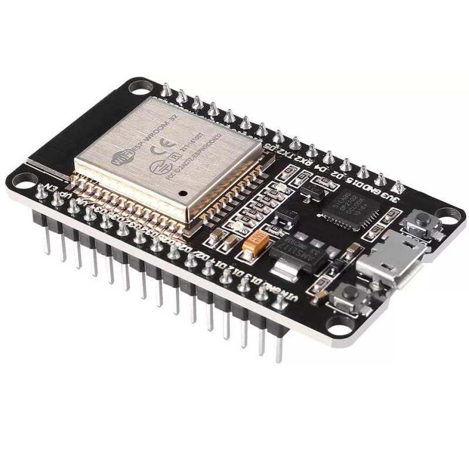
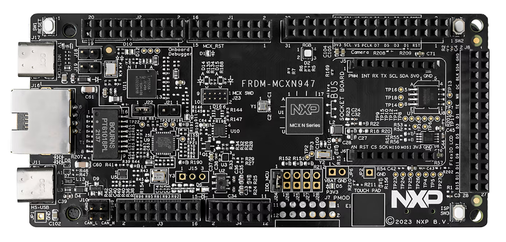
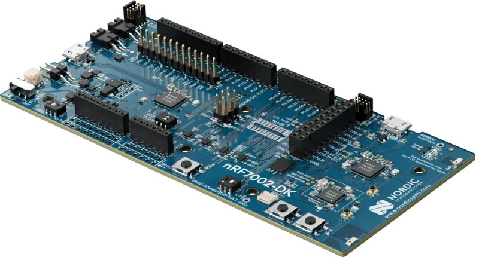
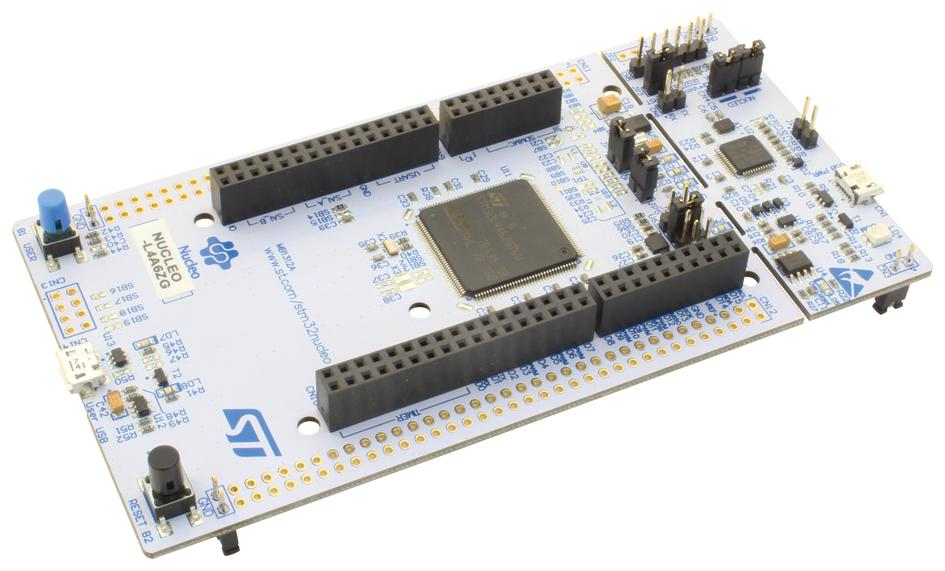
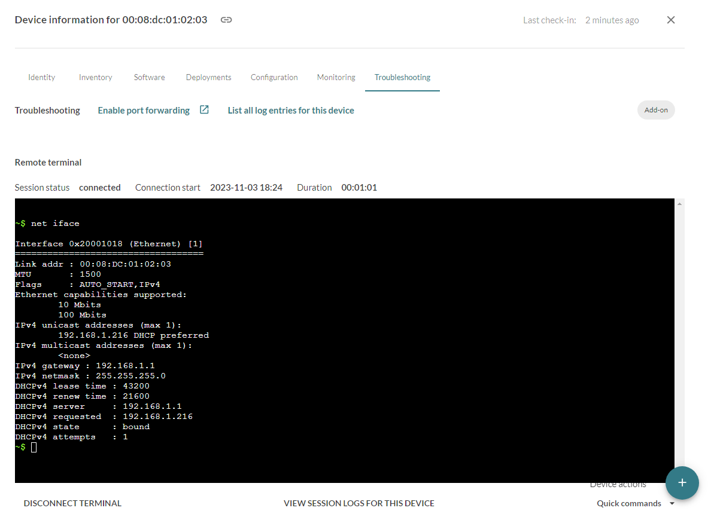

# mender-zephyr-example

[](https://github.com/joelguittet/mender-zephyr-example/actions)
[](https://github.com/joelguittet/mender-zephyr-example/actions)
[](https://github.com/joelguittet/mender-zephyr-example/issues)
[](https://github.com/joelguittet/mender-zephyr-example/blob/master/LICENSE)

[](https://sonarcloud.io/dashboard?id=joelguittet_mender-zephyr-example)
[](https://sonarcloud.io/dashboard?id=joelguittet_mender-zephyr-example)
[](https://sonarcloud.io/dashboard?id=joelguittet_mender-zephyr-example)
[](https://sonarcloud.io/dashboard?id=joelguittet_mender-zephyr-example)
[](https://sonarcloud.io/dashboard?id=joelguittet_mender-zephyr-example)

[](https://sonarcloud.io/dashboard?id=joelguittet_mender-zephyr-example)
[](https://sonarcloud.io/dashboard?id=joelguittet_mender-zephyr-example)
[](https://sonarcloud.io/dashboard?id=joelguittet_mender-zephyr-example)

[Mender MCU client](https://github.com/joelguittet/mender-mcu-client) is an open source over-the-air (OTA) library updater for MCU devices. This demonstration project runs on several hardware platforms using Zephyr RTOS.


## Getting started

This project is used with one of the following setup.

* [Espressif ESP32-DevKitC](https://www.espressif.com/en/products/devkits/esp32-devkitc/overview) development board

This board is well known and has a very low cost, providing a perfect choice to start developing applications using the embedded Wi-Fi interface.



* [NXP FRDM-MCXN947](https://www.nxp.com/design/design-center/development-boards-and-designs/FRDM-MCXN947) development board

This board has Dual Arm Cortex-M33 cores and NPU and it targets AI and Machine Learning applications.



* [Nordic Semiconductor nRF7002-DK](https://www.nordicsemi.com/Products/Development-hardware/nRF7002-DK) development kit

This board is the development kit for nRF7002 Wi-Fi 6 companion IC. It is based on nRF5340 MCU. While support using the Nordic Connect SDK environement is also provided throw the [mender-ncs-example](https://github.com/joelguittet/mender-ncs-example) repository, it is also possible to build a vanilla Zephyr application.



* [STMicroelectronics NUCLEO-L4A6ZG](https://www.st.com/en/evaluation-tools/nucleo-l4a6zg.html) development board

Together with a network IC such as the [W5500](https://wiznet.io/products/ethernet-chips/w5500). The device tree overlay `app/boards/nucleo_l4a6zg.overlay` specifies the wiring of the module W5500 used in the project, as illustrated on the following image, and it is possible to adapt it to your own hardware.



The project is built using Zephyr RTOS v4.4.x (v4.4-branch) and Zephyr SDK >= v0.17.4. [TODO: UPDATE version if required]

To start using Mender, we recommend that you begin with the Getting started section in [the Mender documentation](https://docs.mender.io).

To start using Zephyr, we recommend that you begin with the Getting started section in [the Zephyr documentation](https://docs.zephyrproject.org/latest/develop/getting_started/index.html). It is highly recommended to be familiar with Zephyr environment and tools to use this example.

### Open the project

Initiate a new workspace using the following commands. This will download the dependencies of the example application.

The projects depends on [cJSON](https://github.com/DaveGamble/cJSON) and [msgpack-c](https://github.com/msgpack/msgpack-c) (if troubleshoot add-on support is integrated, see below).

```
mkdir workspace-zephyr
cd workspace-zephyr
git clone https://github.com/joelguittet/mender-zephyr-example
cd mender-zephyr-example
git submodule update --init --recursive
west init -l .
west update
```

### Configuration of the application

The example application should first be configured in `app/prj.conf` to set at least:
- `CONFIG_MENDER_SERVER_TENANT_TOKEN` to set the Tenant Token of your account on "https://hosted.mender.io" server.

You may want to customize few interesting settings:
- `CONFIG_EXAMPLE_WIFI_SSID` and `CONFIG_EXAMPLE_WIFI_PSK` for boards supporting Wi-Fi.
- `CONFIG_MENDER_SERVER_HOST` if using your own Mender server instance. Tenant Token is not required in this case.
- `CONFIG_MENDER_CLIENT_AUTHENTICATION_POLL_INTERVAL` is the interval to retry authentication on the mender server.
- `CONFIG_MENDER_CLIENT_UPDATE_POLL_INTERVAL` is the interval to check for new deployments.
- `CONFIG_MENDER_CLIENT_INVENTORY_REFRESH_INTERVAL` is the interval to publish inventory data.
- `CONFIG_MENDER_CLIENT_CONFIGURE_REFRESH_INTERVAL` is the interval to refresh device configuration.

Other settings are available in the Kconfig. You can also refer to the mender-mcu-client API and configuration keys.

### Building and flashing the application

Some boards depends on binary blobs. You can download them using the following commands.

* Espressif ESP32-DevKitC development board
```
west blobs fetch hal_espressif
```
* Nordic Semiconductor nRF7002-DK development kit
```
west blobs fetch nrf_wifi
```

The application relies on mcuboot and requires to build a signed binary file to be flashed on the evaluation board.

Use the following commands to build mcuboot and the application all together using sysbuild, depending of the board being used:

* Espressif ESP32-DevKitC development board
```
west build -b esp32_devkitc/esp32/procpu --sysbuild app
```
* NXP FRDM-MCXN947 development board
```
west build -b frdm_mcxn947/mcxn947/cpu0 --sysbuild app
```
* Nordic Semiconductor nRF7002-DK development kit
```
west build -b nrf7002dk/nrf5340/cpuapp --sysbuild app
```
* STMicroelectronics NUCLEO-L4A6ZG development board
```
west build -b nucleo_l4a6zg --sysbuild app
```

Finaly flash the board using the following command. Both mcuboot and the application will be flashed.

```
west flash
```

### Execution of the application [TODO: update logs]

After flashing the application on the development board and opening a terminal to display the logs, you should be able to see the following:

```
[00:00:03.790,000] <inf> mender_zephyr_example: Running project 'mender-zephyr-example' version '0.1.0'
[00:00:03.809,000] <inf> mender_zephyr_example: Mender client initialized
[00:00:03.812,000] <inf> mender: WEST_TOPDIR/modules/lib/mender-mcu-client/platform/storage/zephyr/nvs/src/mender-storage.c (243): Device configuration not available
[00:00:03.829,000] <inf> mender_zephyr_example: Mender configure add-on registered
[00:00:03.839,000] <inf> mender_zephyr_example: Mender inventory add-on registered
[00:00:03.849,000] <inf> mender_zephyr_example: Mender device configuration retrieved
[00:00:03.877,000] <inf> mender: WEST_TOPDIR/modules/lib/mender-mcu-client/platform/storage/zephyr/nvs/src/mender-storage.c (111): Authentication keys are not available
[00:00:03.894,000] <inf> mender: WEST_TOPDIR/modules/lib/mender-mcu-client/platform/tls/generic/mbedtls/src/mender-tls.c (118): Generating authentication keys...
[00:03:52.301,000] <inf> mender: WEST_TOPDIR/modules/lib/mender-mcu-client/platform/storage/zephyr/nvs/src/mender-storage.c (183): Deployment data not available
[00:03:52.307,000] <inf> mender_zephyr_example: Mender client connect network
[00:03:58.683,000] <err> mender: WEST_TOPDIR/modules/lib/mender-mcu-client/core/src/mender-api.c (514): [401] Unauthorized: dev auth: unauthorized
[00:03:58.689,000] <err> mender_zephyr_example: Mender client authentication failed (1/3)
[00:03:58.699,000] <inf> mender_zephyr_example: Mender client released network
```

Which means you now have generated authentication keys on the device. Generating is a bit long (depending of the hardware) but authentication keys are stored in the device so it's done only the first time the device is flashed. You now have to accept your device on the mender interface. Once it is accepted on the mender interface the following will be displayed:

```
[00:10:02.176,000] <inf> mender_zephyr_example: Mender client connect network
[00:10:13.205,000] <inf> mender_zephyr_example: Mender client authenticated
[00:10:13.215,000] <inf> mender: CMAKE_SOURCE_DIR/components/mender-mcu-client/core/src/mender-client.c (884): Checking for deployment...
[00:10:17.791,000] <inf> mender: CMAKE_SOURCE_DIR/components/mender-mcu-client/core/src/mender-client.c (892): No deployment available
[00:10:17.805,000] <inf> mender_zephyr_example: Mender client released network
```

Congratulation! Your device is connected to the mender server. Device type is `mender-zephyr-example` and the current software version is displayed.

### Create a new deployment [TODO: update logs]

First retrieve [mender-artifact](https://docs.mender.io/downloads#mender-artifact) tool.

Change `VERSION` file to `VERSION_MAJOR=0` and `VERSION_MINOR=2`, rebuild the firmware using the same command already used.

* Espressif ESP32-DevKitC development board
```
west build -b esp32_devkitc/esp32/procpu --sysbuild app
```
* NXP FRDM-MCXN947 development board
```
west build -b frdm_mcxn947/mcxn947/cpu0 --sysbuild app
```
* Nordic Semiconductor nRF7002-DK development kit
```
west build -b nrf7002dk/nrf5340/cpuapp --sysbuild app
```
* STMicroelectronics NUCLEO-L4A6ZG development board
```
west build -b nucleo_l4a6zg --sysbuild app
```

Then create a new artifact using the following command line:

```
path/to/mender-artifact write rootfs-image --compression none --device-type mender-<board_name>-zephyr-example --artifact-name mender-<board_name>-zephyr-example-v0.2.0 --output-path build/zephyr/mender-<board_name>-zephyr-example-v0.2.0.mender --file build/zephyr/zephyr.signed.bin
```

Where `<board_name>` is the name of the board:

* Espressif ESP32-DevKitC development board
```
path/to/mender-artifact write rootfs-image --compression none --device-type mender-esp32-devkitc-zephyr-example --artifact-name mender-esp32-devkitc-zephyr-example-v0.2.0 --output-path build/zephyr/mender-esp32-devkitc-zephyr-example-v0.2.0.mender --file build/zephyr/zephyr.signed.bin
```
* NXP FRDM-MCXN947 development board
```
path/to/mender-artifact write rootfs-image --compression none --device-type mender-frdm-mcxn947-zephyr-example --artifact-name mender-frdm-mcxn947-zephyr-example-v0.2.0 --output-path build/zephyr/mender-frdm-mcxn947-zephyr-example-v0.2.0.mender --file build/zephyr/zephyr.signed.bin
```
* Nordic Semiconductor nRF7002-DK development kit
```
path/to/mender-artifact write rootfs-image --compression none --device-type mender-nrf7002dk-zephyr-example --artifact-name mender-nrf7002dk-zephyr-example-v0.2.0 --output-path build/zephyr/mender-nrf7002dk-zephyr-example-v0.2.0.mender --file build/zephyr/zephyr.signed.bin
```
* STMicroelectronics NUCLEO-L4A6ZG development board
```
path/to/mender-artifact write rootfs-image --compression none --device-type mender-nucleo-l4a6zg-zephyr-example --artifact-name mender-nucleo-l4a6zg-zephyr-example-v0.2.0 --output-path build/zephyr/mender-nucleo-l4a6zg-zephyr-example-v0.2.0.mender --file build/zephyr/zephyr.signed.bin
```

Upload the artifact `mender-<board_name>-zephyr-example-v0.2.0.mender` to the mender server and create a new deployment.

The device checks for the new deployment, downloads the artifact and installs it on the update partition. Then it reboots to apply the update:

```
[00:40:02.176,000] <inf> mender_zephyr_example: Mender client connect network
[00:40:02.186,000] <inf> mender: CMAKE_SOURCE_DIR/components/mender-mcu-client/core/src/mender-client.c (884): Checking for deployment...
[00:40:07.045,000] <inf> mender: CMAKE_SOURCE_DIR/components/mender-mcu-client/core/src/mender-client.c (918): Downloading deployment artifact with id 'eac3b245-5bdd-427f-b763-?
[00:40:11.614,000] <inf> mender_zephyr_example: Deployment status is 'downloading'
[00:40:17.565,000] <inf> mender: CMAKE_SOURCE_DIR/components/mender-mcu-client/core/src/mender-artifact.c (382): Artifact has valid version
[00:40:17.585,000] <inf> mender: CMAKE_SOURCE_DIR/components/mender-mcu-client/platform/flash/zephyr/src/mender-flash.c (42): Start flashing artifact 'zephyr.signed.bin' with s6
[00:40:45.410,000] <inf> mender: CMAKE_SOURCE_DIR/components/mender-mcu-client/core/src/mender-client.c (930): Download done, installing artifact
[00:40:50.039,000] <inf> mender_zephyr_example: Deployment status is 'installing'
[00:40:54.588,000] <inf> mender_zephyr_example: Deployment status is 'rebooting'
[00:40:54.599,000] <inf> mender_zephyr_example: Mender client released network
[00:40:54.610,000] <inf> mender_zephyr_example: Restarting system
uart:~$ *** Booting MCUboot v2.1.0-rc1-36-gfb2cf0ec3da3 ***
*** Using Zephyr OS build v3.7.0 ***
I: Starting bootloader
I: Primary image: magic=unset, swap_type=0x1, copy_done=0x3, image_ok=0x3
I: Scratch: magic=unset, swap_type=0x1, copy_done=0x3, image_ok=0x3
I: Boot source: primary slot
I: Image index: 0, Swap type: test
I: Starting swap using scratch algorithm.
I: Bootloader chainload address offset: 0xe000
I: Jumping to the first image slot


[00:00:02.016,000] <inf> eth_w5500: eth_w5500@0: Link up
[00:00:02.033,000] <inf> mender_zephyr_example: IPv4 address: 192.168.1.216
[00:00:02.044,000] <inf> mender_zephyr_example: Lease time: 43200 seconds
[00:00:02.054,000] <inf> mender_zephyr_example: Subnet: 255.255.255.0
[00:00:02.064,000] <inf> mender_zephyr_example: Router: 192.168.1.1
[00:00:02.074,000] <inf> mender_zephyr_example: MAC address of the device '00:08:dc:01:02:03'
[00:00:02.086,000] <inf> mender_zephyr_example: Running project 'mender-zephyr-example' version '0.2.0'
[00:00:02.103,000] <inf> mender_zephyr_example: Mender client initialized
[00:00:02.113,000] <inf> mender_zephyr_example: Mender client registered hello-world module
[00:00:02.125,000] <inf> mender: CMAKE_SOURCE_DIR/components/mender-mcu-client/platform/storage/zephyr/nvs/src/mender-storage.c (242): Device configuration not available
[00:00:02.143,000] <inf> mender_zephyr_example: Mender configure add-on registered
[00:00:02.154,000] <inf> mender_zephyr_example: Mender inventory add-on registered
[00:00:02.165,000] <inf> mender_zephyr_example: Device configuration retrieved
[00:00:02.177,000] <inf> mender_zephyr_example: Mender client connect network
[00:00:12.840,000] <inf> mender_zephyr_example: Mender client authenticated
[00:00:12.851,000] <inf> mender: CMAKE_SOURCE_DIR/components/mender-mcu-client/platform/flash/zephyr/src/mender-flash.c (146): Application has been mark valid and rollback cancd
[00:00:17.383,000] <inf> mender_zephyr_example: Deployment status is 'success'
[00:00:17.394,000] <inf> mender: CMAKE_SOURCE_DIR/components/mender-mcu-client/core/src/mender-client.c (884): Checking for deployment...
[00:00:21.935,000] <inf> mender: CMAKE_SOURCE_DIR/components/mender-mcu-client/core/src/mender-client.c (892): No deployment available
[00:00:21.949,000] <inf> mender_zephyr_example: Mender client released network

```

Congratulation! You have updated the device. Mender server displays the success of the deployment.

### Failure or wanted rollback

In case of failure to connect and authenticate to the server the current example application performs a rollback to the previous release.
You can customize the behavior of the example application to add your own checks and perform the rollback in case the tests fail.

### Using Device Troubleshoot add-on

The Device Troubleshoot add-on permits to display the Zephyr Shell on the Mender interface. Autocompletion and colors are available.



The Device Troubleshoot add-on also permits to upload/download files to/from the Mender server. The littlefs partition mounted at `/littlefs` is used to demonstrate this feature. To send a file to the device, destination path must start with `/littlefs`. To download a file from the device the full path is expected, starting with `/littlefs`.

The Device Troubleshoot add-on feature are integrated using `troubleshoot.conf` and `troubleshoot-file-transfer.conf` Kconfig fragments, for example using the following commands.

* To activate shell only
```
west build -b <board_name> --sysbuild app -- -DEXTRA_CONF_FILE="troubleshoot.conf"
```

* To activate shell and file transfert support
```
west build -b <board_name> --sysbuild app -- -DEXTRA_CONF_FILE="troubleshoot.conf;troubleshoot-file-transfer.conf"
```

Please note that due to llimited amount of memory available, the Device Troubleshoot integration is not recommended on ESP32-DevKitC and NUCLEO-L4A6ZG.

### Download and execute an LLEXT module [TODO: to be retested/updated]

This example application supports LLEXT feature to permit loading and executing LLEXT modules using mender-mcu-client.

Compile the hello-world LLEXT sample from Zephyr as below:

```
west build -d build-llext -b nucleo_l4a6zg samples/subsys/llext/modules
```

Then create a new artifact using the following command line:

```
path/to/mender-artifact write module-image --compression none --device-type mender-zephyr-example --artifact-name hello-world-v1 --type hello-world --output-path build-llext/zephyr/mender-module-hello-world-v1.mender --file build-llext/zephyr/hello_world.llext
```

Upload the artifact `mender-module-hello-world-v1.mender` to the mender server and create a new deployment.

The device checks for the new deployment, downloads the artifact and call the `hello_world` function of the module, which is simply displaying `Hello, world, from an llext!` log in the console:

```
[00:00:12.987,000] <inf> mender: CMAKE_SOURCE_DIR/components/mender-mcu-client/core/src/mender-client.c (884): Checking for deployment...
[00:00:17.583,000] <inf> mender: CMAKE_SOURCE_DIR/components/mender-mcu-client/core/src/mender-client.c (918): Downloading deployment artifact with id '360e14aa-33d2-4f99-af7d-A
[00:00:22.177,000] <inf> mender_zephyr_example: Deployment status is 'downloading'
[00:00:27.725,000] <inf> mender: CMAKE_SOURCE_DIR/components/mender-mcu-client/core/src/mender-artifact.c (382): Artifact has valid version
[00:00:27.751,000] <inf> mender: CMAKE_SOURCE_DIR/components/mender-mcu-client/core/src/mender-client.c (930): Download done, installing artifact
[00:00:32.275,000] <inf> mender_zephyr_example: Deployment status is 'installing'
Hello, world, from an llext!
[00:00:36.817,000] <inf> mender_zephyr_example: Deployment status is 'success'
```

### Using an other zephyr evaluation board

The zephyr integration into the mender-mcu-client is generic and it is not limited to the boards available in this repository.
Several points discussed below should be taken into consideration to use an other hardware, including evaluation boards with other MCU families.

#### Flash sectors size

The flash sector size is an important criteria to select an evaluation board. As an example the STM32L4A6ZG MCU has 2KB sectors, which is very convenient to define a custom layout. Other MCUs have variable sectors size and it can be very difficult to choose the partitions.

What remains important is that partitions are aligned on sectors. Moreover `slot0_partition` and `slot1_partition` must have the same size.

#### Configuration of the storage partition

The storage partition should be at least 4KB and must contains at least 3 sectors. As an example on the NUCLEO-L4A6ZG the size of the `storage_partition` is 8KB and the configuration is set with `CONFIG_MENDER_STORAGE_SECTOR_COUNT=4` (4 sectors of 2KB). You should adapt this if you have a different flash layout.

#### Using an other network interface

This application illustrates the usage of different kind of interfaces (Ethernet, Wi-Fi). The mender-mcu-client expect to have a TCP-IP interface but it is not constraint by the physical hardware.

### Using an other mender instance

The communication with the server is done using HTTPS. To get it working, the Root CA that is providing the server certificate should be integrated and registered in the application (see `tls_credential_add` in the `src/main.c` file). Format of the expected Root CA certificate is DER.
In this example we are using the `https://hosted.mender.io` server. While checking the details of the server certificate in your browser, you will see that is is provided by Amazon Root CA 1. Thus the Amazon Root CA 1 certificate `AmazonRootCA1.cer` retrieved at `https://www.amazontrust.com/repository` is integrated in the application.

Using another instance you may need to integrate another Root CA certificate. Also note depending of the certificate properties you may need to activate additional cipher suites in the mbedTLS configuration. See below considerations when using trial mender instance for example.

### Using a trial mender instance

The trial mender instance which is available for free at `http://hosted.mender.io` to test mender feature requires to integrate the Google Trust Services Root R4 certificate together with Amazon Root CA 1 certificate. This is required because the artifacts are saved on a Cloudflare server instead of the Amazon S3 storage. This is achieved using the secondary root certificate support provided by the mender-mcu-client.

```
CONFIG_MENDER_NET_CA_CERTIFICATE_TAG_PRIMARY=1
CONFIG_MENDER_NET_CA_CERTIFICATE_TAG_SECONDARY=2
```

However, default mbedTLS configuration has only symmetric cipher to keep the size of the binary small. Particularly, the support of ECDSA with SHA384 which is required to parse the Google Trust Services Root R4 certificate need to be added to the configuration. This is achieved using the following configurations.

```
CONFIG_MBEDTLS_ECP_DP_SECP384R1_ENABLED=y
CONFIG_MBEDTLS_SHA384=y
CONFIG_MBEDTLS_ECP_NIST_OPTIM=y
```

Those configurations are also available using the Kconfig fragment `trial.conf` in the build configuration.

## License

Copyright joelguittet and mender-mcu-client contributors

Licensed under the Apache License, Version 2.0 (the "License");
you may not use this file except in compliance with the License.
You may obtain a copy of the License at

    http://www.apache.org/licenses/LICENSE-2.0

Unless required by applicable law or agreed to in writing, software
distributed under the License is distributed on an "AS IS" BASIS,
WITHOUT WARRANTIES OR CONDITIONS OF ANY KIND, either express or implied.
See the License for the specific language governing permissions and
limitations under the License.